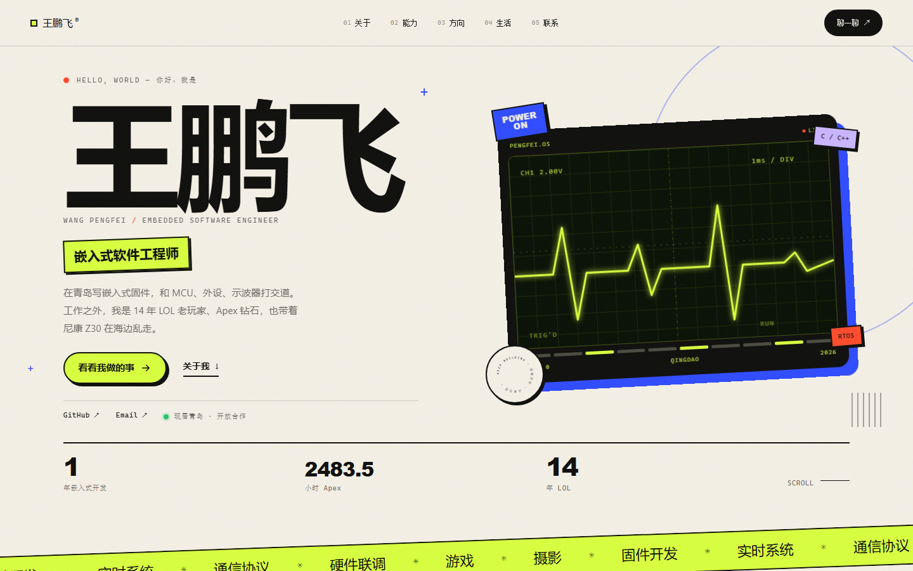

# 王鹏飞 · 个人网站

一个为嵌入式软件工程师打造的个人主页：**专业能力、工作项目、个人生活**三个模块，外加一点属于硬件工程师的浪漫（示波器、波形、引脚）。

纯手写 HTML / CSS / JavaScript，**零依赖、零构建、零框架**。下载后双击 `index.html` 就能看，上传到 GitHub 就能上线。

- **线上地址**：<https://serein021.github.io/>
- **GitHub 仓库**：<https://github.com/Serein021/Serein021.github.io>



---

## 先看效果

直接双击根目录的 `index.html`。

如果装了 Python，也可以在项目目录运行一个本地服务器（可选）：

```bash
python -m http.server 8000
```

然后打开 <http://localhost:8000>。

---

## 页面里有什么

| 区块 | 内容 |
| --- | --- |
| Hero | 超大姓名、职位、示波器动态波形、关键数据 |
| 01 关于 | 个人介绍、正在做的事（NOW）、基本信息 |
| 02 专业能力 | 六宫格能力卡片 + 工具箱标签 |
| 03 工作与方向 | 3 个可公开方向、1 段工作履历、SLAM 课程项目 |
| 04 生活现场 | 游戏 / Apex / 尼康 Z30 / 青岛 / 休息日 / 游戏库 / 照片墙 |
| 05 联系 | 邮箱一键复制、社交链接 |
| 404 | 一个「信号丢失」的彩蛋页 |

设计特点：酸性荧光绿 + 电光蓝 + 朱红的撞色、粗黑标题、硬阴影、轻微倾斜的卡片、滚动进场动画。支持键盘导航、`prefers-reduced-motion`、响应式（手机 / 平板 / 桌面）和打印。

---

## 目录结构

```text
.
├── index.html                  # 整个网站（内容都在这里改）
├── 404.html                    # GitHub Pages 自定义 404
├── robots.txt
├── sitemap.xml                 # 记得把域名换成你自己的
├── .nojekyll                   # 告诉 GitHub Pages 不要用 Jekyll 处理
├── assets/
│   ├── css/style.css           # 全部样式
│   ├── js/main.js              # 全部交互
│   └── img/
│       ├── favicon.svg         # 网站图标
│       └── portrait.svg        # 头像插画（可换成你的照片）
├── extras/
│   └── github-actions-deploy.yml  # 可选的 Actions 部署配置（默认不用）
├── preview/                    # 预览截图（可删）
└── README.md
```

---

## 5 分钟上线到 GitHub Pages

不需要安装 Git，也不需要命令行，全部在网页上完成。

### 第 1 步：新建仓库

1. 登录 GitHub，点右上角 **+ → New repository**。
2. **Repository name** 填：

   ```text
   你的GitHub用户名.github.io
   ```

   例如用户名是 `wangpengfei`，就填 `wangpengfei.github.io`。
   这样上线后的地址就是 `https://wangpengfei.github.io`（最干净的地址）。

   > 也可以随便起名，比如 `my-site`，地址会变成 `https://用户名.github.io/my-site/`。站内全部使用相对路径，两种都可以正常工作。

3. 可见性选 **Public**（免费账号的 Pages 需要公开仓库）。
4. 点 **Create repository**。

### 第 2 步：上传文件

1. 在仓库页面点 **Add file → Upload files**。
2. 把本项目里的这些内容**全部拖进去**（保持文件夹结构）：
   - `index.html`
   - `404.html`
   - `robots.txt`
   - `sitemap.xml`
   - `.nojekyll`
   - `assets/`（整个文件夹）
   - `extras/`（可选）
   - `preview/`（可选，README 里的预览图）
   - `README.md`（可选）
3. 点 **Commit changes**。

> `.nojekyll` 是空文件，Windows 资源管理器默认能看见。如果拖拽时被忽略，不影响主要功能；也可以之后点 **Add file → Create new file**，文件名填 `.nojekyll`，内容留空，提交即可。

### 第 3 步：开启 Pages

1. 进入仓库 **Settings → Pages**。
2. **Build and deployment → Source** 选择 **Deploy from a branch**。
3. **Branch** 选 `main`，目录选 `/ (root)`，点 **Save**。
4. 等 1～2 分钟，刷新页面，顶部会出现你的网址。

访问：

```text
https://你的用户名.github.io
```

### 第 4 步：以后怎么更新

直接在 GitHub 网页里点开 `index.html`，点铅笔图标编辑，提交后 1 分钟左右自动生效。

---

## 改成你自己的内容

首页所有文字都在 `index.html` 里，用编辑器的「查找」逐项替换即可。

### 必改清单

| 查找 | 替换为 | 出现位置 |
| --- | --- | --- |
| `王鹏飞` | 你的名字 | 标题、导航、正文、页脚 |
| `WANG PENGFEI` | 你的英文名 / 拼音 | Hero、头像图 |
| `嵌入式软件工程师` | 你的职业 | Hero、About、SEO |
| `2529870224@qq.com` | 你的邮箱（HTML 6 处 + JS 1 处） | Hero、About、Contact、复制按钮 |
| `https://github.com/Serein021` | 你的 GitHub 主页（已设置） | Hero、Contact、JSON-LD |
| `青岛` / `QINGDAO` | 你的城市 | Hero、About、Contact、头像图 |
| `1` 年 / `2483.5` / `14` | 你的经验与游戏数据 | Hero 数据条、生活区 |
| `https://serein021.github.io/` | 你的正式网址（已设置） | canonical、JSON-LD、robots、sitemap |

> 「复制邮箱」按钮读取的是 `assets/js/main.js` 顶部的 `EMAIL` 常量，改邮箱时别忘了同步这一处。

### 内容模块

- **关于我**：`.about-text` 里的三段文字、`.about-lead` 的自我介绍、`.now` 里的「在做 / 在玩 / 在拍 / 在学」。
- **专业能力**：六个 `.skill-card`，可以改标题、描述、标签，也可以删掉或复制一张卡片。卡片配色由 `skill-card--acid / --blue / --lilac / --ink / --verm / --paper` 控制。
- **工作与方向**：三个 `.project`，只写可公开的方向，不写客户、公司、具体参数。
- **履历**：`.exp-grid--two` 里的两段经历。
- **生活**：六张 `.life-card`（Apex / 尼康 Z30 / 青岛 / 游戏库 / 休息日 / 最近）、`.game-library` 六行游戏记录、`.photo-wall` 六张照片。
- **照片**：照片墙目前是 `assets/img/life/*.svg` 插画占位；换成真人照片时，把文件放进 `assets/img/life/`，并修改对应 `` 和 `data-full`。
- **SEO**：`<title>`、`description`、Open Graph、JSON-LD 里的姓名/职位/城市/链接。

### 换头像（推荐）

现在用的是 `assets/img/portrait.svg` 插画占位图。换成真人照片：

1. 把照片命名为 `me.jpg`，放进 `assets/img/`。
2. 在 `index.html` 里把：

   ```html
   
   ```

   改成：

   ```html
   
   ```

3. 建议竖图，比例 5:6（例如 1000×1200），文件控制在 300KB 以内。

### 给生活卡片加照片

生活区目前是纯色 + 图标的图形卡片，保持统一风格。想换成照片，可以在 CSS 里给对应卡片加背景图：

```css
.life-card--cycling {
  background: #2f4bff url("../img/cycling.jpg") center / cover;
}
```

深色照片上文字可能看不清，建议再加一层遮罩：

```css
.life-card--cycling::before {
  content: "";
  position: absolute;
  inset: 0;
  background: linear-gradient(180deg, rgba(14,14,12,.15), rgba(14,14,12,.72));
}
.life-card--cycling > * { position: relative; z-index: 1; }
```

---

## 自定义域名（可选）

1. 在域名服务商处添加解析：
   - `www` → CNAME → `你的用户名.github.io`
   - 根域名 `@` → A 记录 → GitHub Pages 的四个 IP（在 GitHub 文档里可查）
2. 仓库 **Settings → Pages → Custom domain** 填入域名并保存。
3. 等 DNS 生效后勾选 **Enforce HTTPS**。
4. 把 `robots.txt`、`sitemap.xml` 和 `<head>` 里的地址换成新域名。

---

## 常见问题

**页面能打开但没有样式？**
检查 `assets` 文件夹是否上传到了仓库根目录，以及文件名大小写是否一致（Linux 服务器区分大小写）。

**访问显示 404？**
确认 `index.html` 在仓库根目录，而不是在某个子文件夹里；确认 Pages 的 Branch 是 `main`、目录是 `/ (root)`。

**国内访问 GitHub Pages 有点慢？**
这是常见情况。可以绑定自己的域名、使用 Cloudflare 加速，或把同一份静态文件部署到 Cloudflare Pages / Vercel。代码不需要改。

**想用 GitHub Actions 自动部署？**
仓库里已经放了一份可选配置 `extras/github-actions-deploy.yml`。把它复制到 `.github/workflows/deploy.yml`，然后在 **Settings → Pages → Source** 选择 **GitHub Actions**。注意：启用 Actions 后不要再选「Deploy from a branch」，两种方式二选一。

**想加博客 / 文章列表？**
可以在「生活切片」前复制一个 `<section class="section">`，沿用 `.section-head`、`.tags` 等现成样式。文章不多时，纯 HTML 比引入静态站点框架更省心。

---

## 设计与实现说明

- 字体全部使用系统字体（Arial Black / PingFang SC / 微软雅黑 / Consolas），**不请求任何外部字体或 CDN**，国内加载快，也不依赖网络。
- 所有图片都是本地 SVG，没有第三方图床。
- 动效：IntersectionObserver 进场、滚动进度条、导航高亮、跑马灯、示波器波形（SVG + SMIL）、卡片轻微跟随鼠标倾斜。
- 已处理：语义化标签、跳转链接、焦点样式、`aria-expanded`、减少动效偏好、移动端全屏菜单、打印样式。
- 没有构建步骤，所以不需要 `package.json`、Node 或 npm。

---

## 内容声明

- 工作区只写可公开的方向，不写公司、客户和具体参数；这是有意为之。
- 照片墙目前是插画占位，收到真人照片后替换即可；头像同理。
- 游戏时长、段位、相机和城市信息来自本人确认，后续有变化时记得同步更新。

## License

代码可自由使用、修改。文字、照片与个人信息归你本人所有。
